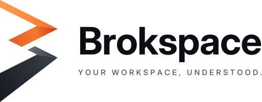

<p align="center">
  <picture>
    <source media="(prefers-color-scheme: dark)" srcset=".github/brokspace-on-dark.svg">
    
  </picture>
</p>
<p align="center"><b>Brokspace IDE: your workspace, understood.</b></p>

An IDE with Brokspace built in: local-first search across every repository in
your folder, an agent that answers from your own LLM with the sources it used,
reviews and commit messages, skills and shards. Use Brokspace in **IDE mode**
(this app) or **CLI mode** (`brok`); both share the same workspace.

Built on [Eclipse Theia](https://theia-ide.org), so VS Code extensions from
[Open VSX](https://open-vsx.org) work too.

## What's inside

| | |
|---|---|
| **Layout** | Minimal by default: Explorer, Search, Source Control and Brokspace on the left, the Brokspace agent docked on the right. Debug, Testing, Extensions and Outline stay one shortcut away |
| **Home** | Ask about the workspace or describe a change; suggestions, open a folder, recent workspaces |
| **Brokspace view** | **Overview** (service, model, index, search that opens results at the line, Ask / Review / Commit), **Memory** (recent decisions, facts and chat sessions; remember, open, forget), **Shards** (state, permissions, topics and source of each shard; install, create, remove, browse) and **Skills** |
| **Brokspace settings** | One page in the editor area (`Ctrl+Alt+,`, or the gear in the Brokspace view): overview, AI model and providers, search and index, memory, linked workspaces, coding agents and diagnostics. Changes are validated and saved to `brok.yml` at once |
| **Memory** | What Brokspace remembers between sessions, found in every answer: private, shared with the team through git, or global to all your workspaces. Each chat with the agent is remembered; `Ctrl+Alt+M` remembers a decision or the selected code |
| **Linked workspaces** | Link the services your workspace depends on (a folder or a git URL): answers and search know both, with paths that open in the IDE |
| **Diagnostics and bug reports** | Brokspace settings › Diagnostics shows local metrics (search and answer latency, indexing, recent errors) and `brok doctor`'s checks with their fixes. **Report a Bug…** (and Help › Report an IDE Issue, or the button on a failed command) prepares a report with the diagnostics, secrets masked, and opens a prefilled GitHub issue |
| **Brokspace agent** | The one way to an LLM: every request goes through brok, which routes it to the provider in `brok.yml`. Follow-ups, `/review`, `/review staged`, `/review base main`, `/skill <name> <input>`. Without an LLM it answers with what the local index finds |
| **Agent focus mode** | `Ctrl+Shift+A` (`Cmd+Shift+A`): the agent takes most of the window; again to go back |
| **Source control** | ✨ in the Source Control toolbar writes the commit message from the staged changes |
| **Brokspace menu and commands** | Set up, start/stop, rebuild the index, doctor, shards, export skills to coding agents |
| **Languages** | English and Brazilian Portuguese: the IDE starts in pt-BR on Portuguese systems; switch with *Language* on the home page (Configure Display Language) |
| **Status bar** | Service state and model at a glance |
| **brok included** | `brok` and `brok-agent` ship with the IDE and are on `PATH` in its terminals; the installers put them on your `PATH` too |
| **Themes** | Brokspace Dark (default) and Brokspace Light |

The IDE talks to Brokspace only through the `brok` CLI and its `--json`
output ([contract](https://github.com/brokspace/brok/blob/main/docs/integrations.md)),
so anything the IDE does, you can script. It needs brok 0.4.0 or newer.

## Install

| | |
|---|---|
| **macOS** | `brew install --cask brokspace/tap/brokspace-ide` |
| **Debian / Ubuntu** | Add the [Brokspace APT repository](https://brokspace.github.io/apt), then `sudo apt install brokspace-ide` |
| **Linux (other)** | AppImage or `.tar.gz` from the [latest release](https://github.com/brokspace/ide/releases/latest) |
| **Windows** | `BrokspaceIDE-<version>-windows-x64-setup.exe` from the [latest release](https://github.com/brokspace/ide/releases/latest) |

The IDE updates itself from GitHub Releases. Builds are not code-signed yet
([plan](https://github.com/brokspace/brok/blob/main/docs/maintainers/code-signing.md)):
on macOS, open it the first time with right click > Open; on Windows, choose
"More info > Run anyway" in SmartScreen.

You need an LLM for answers (search works without one): see
[getting started](https://github.com/brokspace/brok/blob/main/docs/getting-started.md#2-get-a-local-llm-optional).

## Develop

Requirements: Node.js 24, Yarn 1, git, and on Linux `libxkbfile-dev` and
`libsecret-1-dev` (or use `.devcontainer/Dockerfile`).

```sh
yarn                       # install
yarn build:extensions      # compile theia-extensions/*
yarn download:plugins      # VS Code built-in extensions + plugins-local/*
yarn browser build         # browser app (fastest to try)
yarn browser start         # http://localhost:3000

node scripts/fetch-brok.mjs   # bundle brok for this machine
yarn electron build && yarn electron start
yarn electron package         # installers in applications/electron/dist
```

User-facing strings go through `nls.localize('brokspace/<area>/<key>', 'English text')`.
After adding or changing one, run `yarn i18n:extract` (updates
`theia-extensions/product/i18n/nls.json`), add the Portuguese to
`nls.pt-br.json`, and check with `yarn i18n:check` (CI runs it too).

To try installers without building them yourself, use the Package workflow:
it runs on pull requests that touch packaging and on demand
(`gh workflow run package.yml --ref <branch>`), then
`gh run download <run id> -n ide-windows-x64` (or `linux-x64`, `macos-arm64`, ...).

| Path | What |
|---|---|
| `applications/browser`, `applications/electron` | The two app targets and their Theia configuration (defaults: theme, AI, Brokspace agent) |
| `theia-extensions/brok` | Brokspace integration: backend service over the `brok` CLI, view, chat agent, commands, status bar |
| `theia-extensions/product` | Branding: home page, about dialog, help menu |
| `theia-extensions/updater`, `launcher` | Auto-update from GitHub Releases; CLI launcher for AppImage |
| `plugins-local/brokspace-theme` | Brokspace Dark and Light color themes |
| `packaging/homebrew`, `packaging/apt` | Homebrew cask and formula, APT repository builder |
| `scripts/fetch-brok.mjs` | Downloads and verifies brok and brok-agent for packaging |
| `theia-extensions/product/i18n` | Translations: `nls.json` (English, generated) and `nls.pt-br.json` |
| `theia-extensions/product/src/browser/style/tokens.css` | Design tokens: brand colors, spacing, radii, icon sizes |

## Release

1. Bump `version` in the root and workspace `package.json` files and
   `lerna.json` and update the changelog, in a PR to `staging`. Then merge
   the release PR ("release: promote staging to main").
2. Tag `vX.Y.Z` on `main` and push it
   (`git fetch origin && git tag vX.Y.Z origin/main && git push origin vX.Y.Z`). The Release workflow builds every platform,
   uploads installers with `.sha256` files and update metadata, publishes the
   release, then updates the Homebrew tap and the APT repository when their
   secrets are set. One-time setup, step by step:
   [docs/maintainers/package-managers.md](docs/maintainers/package-managers.md).

## Credits

Based on the [Eclipse Theia IDE](https://github.com/eclipse-theia/theia-ide)
(MIT); upstream history is kept, so Theia updates merge from the
`upstream` remote. See [NOTICE.md](NOTICE.md).

## License

MIT, see [LICENSE](LICENSE). The Brokspace name and logo are covered by the
[brand license](https://github.com/brokspace/brand).
